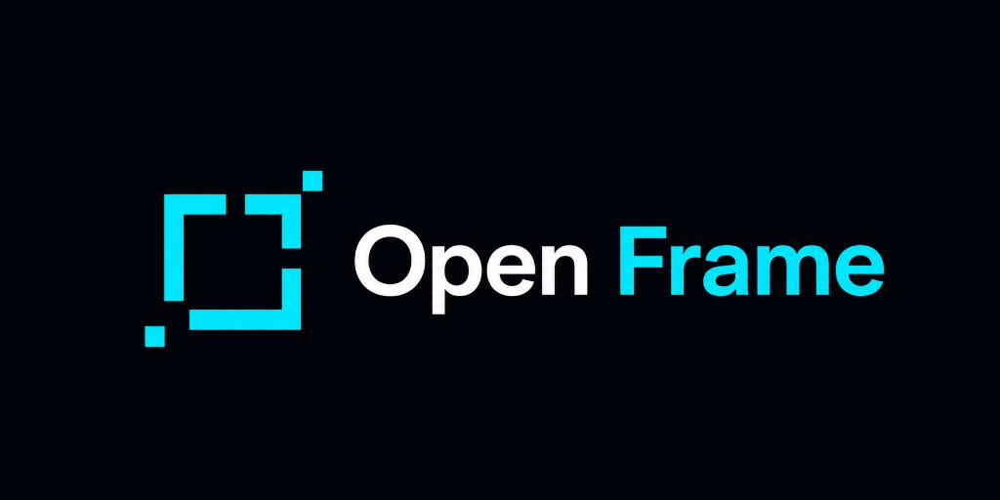
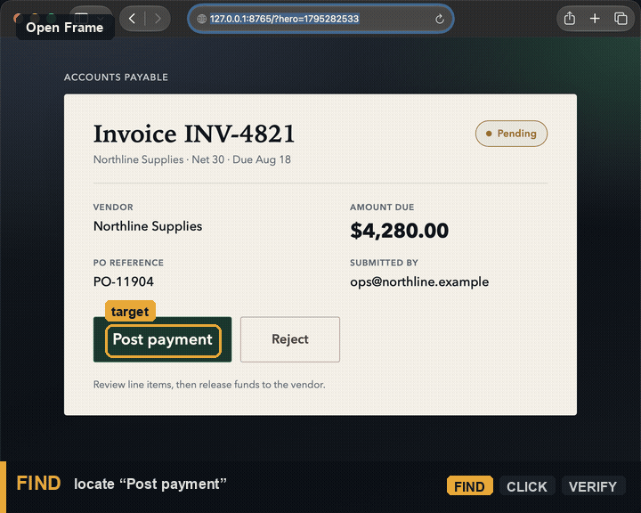

<p align="center">
  
</p>

# Open Frame

Open Frame finds a target on a Mac, clicks or types, and checks the result. The agent decides the step.

<p align="center">
  <a href="https://pypi.org/project/off-camber-open-frame/"></a>
  <a href="LICENSE"></a>
  
  
</p>

<p align="center">
  
</p>

<sub>Above: Open Frame drives a live invoice UI — <strong>FIND</strong> “Post payment”, <strong>CLICK</strong> the match, <strong>VERIFY</strong> “Payment posted to Northline.”</sub>

- **Anything on the display.** Outlook, Finder, Calendar, a browser. The target is the pixels, not a DOM.
- **MCP tools dry-run unless you send the action.**
- **A failed step keeps before and after screenshots.**

```bash
python -m pip install "off-camber-open-frame[mcp,ocr,act,flow,template]"
```

macOS, Python 3.11 or newer, Beta. The [install steps](#install-on-a-mac) cover the Python version and the case where Homebrew belongs to another account.

> Open Frame is an independent project and is not affiliated with or endorsed by any third-party automation vendor.

## Why this exists

Browser agents read a page's structure. They stop where there is no DOM: a mail client, Finder, a system dialog. Licensed RPA sells that capture-and-click loop per bot. Open Frame is the open execution layer an agent calls over MCP: find a target on the screen, perform the step, and return a structured result with the screenshots.

## Status

**Beta** (`v0.3.2`) — macOS-first. Available on PyPI as
[`off-camber-open-frame`](https://pypi.org/project/off-camber-open-frame/).
Evidence for this release comes from CI plus a local macOS live gate (including
MCP stdio smoke); see [release gates](docs/RELEASE_GATES.md). Changelog:
[CHANGELOG.md](CHANGELOG.md).

## Who this is for

- Developers automating desktop workflows.
- Teams who want agent-callable UI execution without bloating context windows.
- Contributors building recognizers, flows, or integrations.

## Install on a Mac

Open Frame requires **Python 3.11 or newer**. That requirement is
`requires-python` in the package metadata. Releases are tested on Python 3.11
and 3.12. macOS only.

`python3` on a Mac is often older than that. Pip 21.x then reports
`No matching distribution found` and `from versions: none`, because it never
reads the current package index. Check `python3.11` before installing.

### 1. Check Python

```bash
python3.11 --version
```

If that command is not found, Homebrew's interpreter may still be installed
for another account:

```bash
/opt/homebrew/bin/python3.11 --version
```

You want a version of 3.11 or newer. If neither command works, install Python
from the macOS account that owns Homebrew:

```bash
brew install python@3.11
```

Installing the official macOS package from [python.org](https://www.python.org/downloads/macos/)
also works. Leave `/opt/homebrew` owned by the account that installed Homebrew.

### 2. Check Tesseract

```bash
tesseract --version
```

When the command is missing and this account can write to Homebrew:

```bash
brew install tesseract
tesseract --version
```

When `brew` cannot write to `/opt/homebrew/Cellar`, Homebrew belongs to another
account on this Mac. From that account, run `brew install tesseract`, or
`brew upgrade tesseract` when an older copy is already installed. Leave
ownership of `/opt/homebrew` unchanged. The binary is then shared. If the
shell still cannot find `tesseract`, call `/opt/homebrew/bin/tesseract`.

### 3. Create a virtual environment

Do this once, using the interpreter from step 1:

```bash
python3.11 -m venv ~/open-frame-env
```

When `python3.11` is not on `PATH`:

```bash
/opt/homebrew/bin/python3.11 -m venv ~/open-frame-env
```

### 4. Activate that environment

Do this in every new terminal. Activating an environment that already exists
is a separate step from creating it, and it applies only to the current terminal:

```bash
source ~/open-frame-env/bin/activate
```

### 5. Upgrade pip and install

```bash
python -m pip install --upgrade pip
python -m pip install "off-camber-open-frame[mcp,ocr,act,flow,template]"
```

`python -m pip` installs into the environment you just activated. The command
installs the latest stable release, which is `0.3.1`. The package is still
labelled Beta.

That command installs the standard extras: `ocr`, `act`, `flow`, `mcp`, and
`template`.

The `agent` extra is not part of it. That extra installs the Anthropic SDK for
the optional agent loop. Leave it out unless you want that loop. In the same
activated environment:

```bash
python -m pip install "off-camber-open-frame[agent]"
```

From a clone of this repository the editable form is
`python -m pip install -e ".[agent]"`. That form is for a checkout, not for a
copy installed from PyPI. See [agent setup](docs/AGENT_SETUP.md).

### 6. Diagnose

```bash
python -m openframe.cli doctor
```

Run doctor with this environment's Python. A shell can still resolve a bare
`open-frame` to another install, such as `/opt/homebrew/bin/open-frame` from a
different account. That process checks the other Python and reports `mcp` and
`template` as missing even when this environment has them. The `python` line
of the report includes the interpreter path. It should sit inside
`~/open-frame-env`.

All required checks should report `pass` (`overall: ok`). After the standard
install, `extra_agent` is `skip` with `optional, not installed (anthropic)`.
That row is a `note`, not a `hint`, and it does not change `overall`. A `fail`
is a problem to fix: a missing Tesseract binary, a privacy denial, or a package
this environment cannot import. Screen Recording and Accessibility show up as
their own checks.

On macOS, grant your terminal or IDE host **Screen Recording** and
**Accessibility** (System Settings → Privacy & Security), then restart that app.
Those are privacy permissions. They are separate from a failed install and from
a missing Tesseract binary.

If a required check fails, see [troubleshooting](docs/TROUBLESHOOTING.md).

### 7. Connect an MCP client

```bash
python -m openframe.cli doctor --mcp
```

This fails when the `mcp`, `act`, or `ocr` extras are missing. When they are
installed it starts the server, lists its tools, and prints a client config
that uses the absolute path of the current Python. Screen Recording and
Accessibility must be granted to the MCP client (Cursor or Claude Desktop),
not the terminal that ran `doctor`.

More client examples: [MCP server setup](docs/MCP_SERVER.md).

```bash
open-frame mcp serve
```

### 8. Run a first flow

```bash
open-frame find "Submit" --json
```

Exit 0 with `"count": 0` means the command worked and that text was not on
screen. A missing permission or a capture failure is a non-zero exit.

```bash
# Write a one-step flow in the current directory. It does not click or type.
# A dry-run still captures the screen before and after the step.
cat > hello.yaml <<'EOF'
name: hello
steps:
  - id: pause
    kind: wait
    ms: 1
EOF
open-frame run hello.yaml --dry-run --json
```

Those before and after images are saved with the run.

Artifacts for that run are written to an absolute directory: `~/.openframe/runs`,
or `OPENFRAME_RUNS_DIR` when that variable is set. Remove old runs with
`open-frame runs prune --older-than 7d --keep 20`.

With the environment activated, `open-frame` is the same program. Prefer
`python -m openframe.cli` when a machine has more than one install, so the
command cannot pick up a different interpreter.

## Local development (repo clone)

```bash
python3.11 -m venv .venv
source .venv/bin/activate
python -m pip install -e ".[dev,ocr,act,flow,mcp,template]"
open-frame doctor
open-frame mcp list-tools --json
```

If `python3.11` is not available on a fresh macOS machine:

```bash
brew install python@3.11
```

## Next steps

- [MCP server setup](docs/MCP_SERVER.md) — Claude Desktop / Cursor config.
- [Flow setup](docs/FLOW_SETUP.md) — define and run YAML flows.
- [Template setup](docs/TEMPLATE_SETUP.md) — optional icon/image matching.
- [API](docs/API.md) — use `Session` and MCP-oriented integration guidance.
- [Act setup](docs/ACT_SETUP.md) and [Verify setup](docs/VERIFY_SETUP.md) — run safely with evidence.
- [Full docs index](docs/README.md) — start here, then the project record.

## License

Apache License 2.0 — free to use, modify, and self-host. See [LICENSE](LICENSE).
